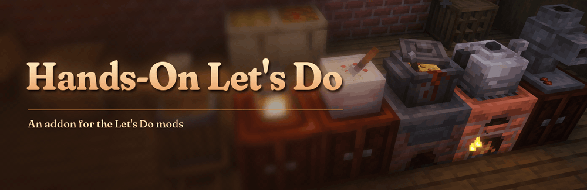
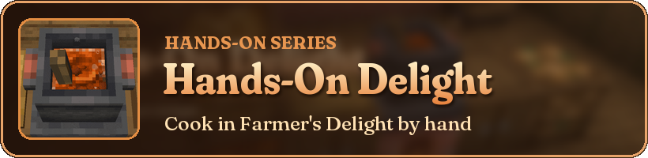
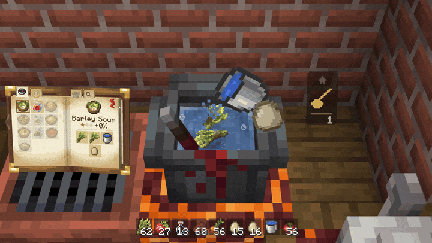
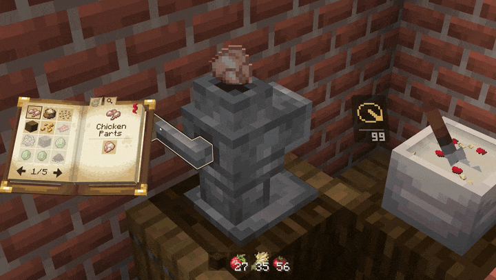
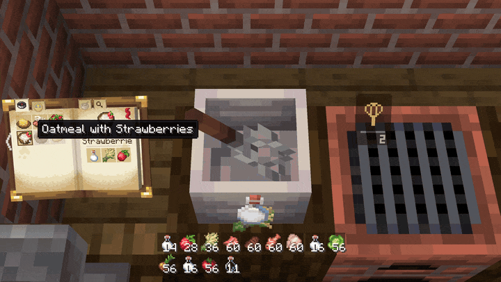
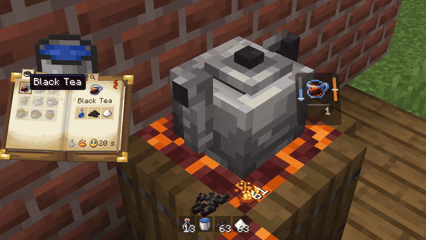

<!-- CurseForge description of Hands-On Let's Do. HTML: paste it in the editor's HTML (source) mode, not Markdown mode.
     The "more-mods" block is generated by tools/mod-catalog/sync_mod_links.py - never edit it by hand.
     Banner and clips: docs/showcase (the banner is drawn by art/page/banner.py). -->

<!-- more-mods:start family -->

 &nbsp; &nbsp;

<!-- more-mods:end -->

    

<em>An addon by Pocky for the <a href="https://www.curseforge.com/members/satisfy/projects">Let's Do</a> mods by satisfy: work at their stations with your own hands.</em>

<strong>The fermentation barrel, the apple press, the cooking pots, the stove, the roaster, the cooking pan, the mincer, the crafting bowl and the tea kettle open right where they stand, with no menu screen. You stir the soup, turn the mincer's crank and whisk the dough yourself, and players nearby see what you make.</strong>

<strong>No menus</strong>, the blocks open in the world &nbsp;&middot;&nbsp; <strong>Every recipe</strong> of the Let's Do mods &nbsp;&middot;&nbsp; <strong>No new blocks or items</strong>

<h2 style="text-align:center">The cooking pot</h2>

<em>Throw the food into the water of <a href="https://www.curseforge.com/minecraft/mc-mods/lets-do-farm-charm">Farm &amp; Charm</a>'s pot and stir it with the pot's own stick. Wide, steady rounds fill stars over the pot, each one adding servings. Bowls dipped into the soup take them out.</em>

<h2 style="text-align:center">The mincer</h2>

<em>Drop meat into the hopper of Farm &amp; Charm's mincer and turn its crank by hand, two turns for each piece, up to eight at once. A heavier load turns slower. The mince comes out of the spout and waits under it.</em>

<h2 style="text-align:center">The crafting bowl</h2>

<em>Pour the milk in, add the oats and the berries and whisk them with the bowl's own whisk. Everything in the bowl moves and thickens as you whisk, until a whole bowlful of porridge, dough or butter is ready.</em>

<h2 style="text-align:center">The tea kettle</h2>

<em>Lift the lid of a <a href="https://www.curseforge.com/minecraft/mc-mods/lets-do-herbal-brews">HerbalBrews</a> kettle, pour the water in and drop the leaves in. Blaze powder at its foot makes it hotter. When the tea is done the kettle whistles. Click its spout with a bottle and it is poured.</em>

<h3 style="text-align:center">Getting started</h3>

Put the mod and <a href="https://www.curseforge.com/minecraft/mc-mods/diegesis">Diegesis</a> into the mods folder of the client and the server, then right-click a station. Each Let's Do mod is optional and brings its own stations. On <a href="https://fabricmc.net">Fabric</a> it needs <a href="https://www.curseforge.com/minecraft/mc-mods/fabric-api">Fabric API</a>. A client without the mod keeps the Let's Do menus. Hoppers keep working, and <code>config/handson_letsdo.properties</code> turns off any station or the stirring the pot waits for.

 Bug reports, questions and ideas for new stations are welcome in <a href="https://discord.gg/mGkPKccJEf">Pocky's Kitchen</a>, our Discord server.

Made by <strong>Pocky</strong>. Built on <a href="https://www.curseforge.com/minecraft/mc-mods/diegesis">Diegesis</a>; the models and sounds of the stations come from the installed Let's Do mods by <a href="https://www.curseforge.com/members/satisfy/projects">satisfy</a>. Source on <a href="https://github.com/Pocky-l/handson-letsdo">GitHub</a> (MIT).

