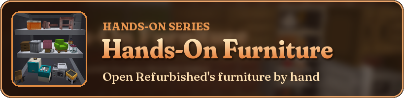

<!-- CurseForge description of Hands-On Let's Do. HTML: paste it in the editor's HTML (source) mode, not Markdown mode.
     The "more-mods" block is generated by tools/mod-catalog/sync_mod_links.py - never edit it by hand.
     The banner (docs/showcase/title.png) and the clips go in once they are recorded, as on Hands-On Delight's page. -->
<!-- more-mods:start family -->

 &nbsp; &nbsp;

<!-- more-mods:end -->

    

<em>An addon by Pocky for the <a href="https://www.curseforge.com/members/satisfy/projects">Let's Do</a> mods by satisfy: work at their stations with your own hands.</em>

<strong>The fermentation barrel, the apple press, the cooking pot, the stove, the roaster and the tea kettle open right where they stand, with no menu screen. You pour the juice into the barrel, stir the soup and swirl the roaster yourself, and players nearby see what you make.</strong>

<strong>No menus</strong>, the blocks open in the world &nbsp;&middot;&nbsp; <strong>Every recipe</strong> of the Let's Do mods &nbsp;&middot;&nbsp; <strong>No new blocks or items</strong>

<h2 style="text-align:center">The fermentation barrel</h2>

<em>Take the hatch off <a href="https://www.curseforge.com/minecraft/mc-mods/lets-do-vinery">Vinery</a>'s barrel, pour the juice in and drop in what goes with it. Put the hatch back on and everything ferments together. The wine waits in the barrel and is drawn at the bung into bottles.</em>

<h2 style="text-align:center">The apple press</h2>

<em>The front of the basket swings open. Lay the apples in, shut it and press the screw's cap: four presses press up to eight apples at once. The juice runs into a small wooden tub under the press, and an empty wine bottle is filled from it.</em>

<h2 style="text-align:center">The cooking pot</h2>

<em>Throw the food into the water of <a href="https://www.curseforge.com/minecraft/mc-mods/lets-do-farm-charm">Farm &amp; Charm</a>'s pot and stir it with the pot's own stick. Wide, steady rounds fill stars over the pot, each one adding servings. Bowls dipped into the soup take them out.</em>

<h2 style="text-align:center">The stove</h2>

<em>Open the door, slide the grate out and lay on it what the bread, the cake or the roast is made of. Coal goes into the firebox below, where you see it burn. Shut the door and the dough browns and rises.</em>

<h2 style="text-align:center">The roaster</h2>

<em>Lay the food into the pan, take the roaster by a handle and swirl it as you would stir a pot. The pieces brown and slide about in the oil, and the roast lies glistening in the pan when it is done.</em>

<h2 style="text-align:center">The tea kettle</h2>

<em>Lift the lid of a <a href="https://www.curseforge.com/minecraft/mc-mods/lets-do-herbal-brews">HerbalBrews</a> kettle, pour the water in and drop the leaves in. Blaze powder at its foot makes it hotter. When the tea is done the kettle whistles. Click its spout with a bottle and it is poured.</em>

<h2 style="text-align:center">Stars and the recipe book</h2>

<em>A recipe book beside every station shows what you can make right now and lays the ingredients in for you. The pot and the roaster give stars for steady stirring, as in <a href="https://www.curseforge.com/minecraft/mc-mods/hands-on-delight">Hands-On Delight</a>.</em>

<h2 style="text-align:center">Station compatibility</h2>

<em>How much of each mod's kitchen opens as stations right in the world.</em>

<table style="margin-left:auto;margin-right:auto" cellpadding="4">
<tbody>
<tr><th>Mod</th><th>Stations</th></tr>
<tr><td> <a href="https://www.curseforge.com/minecraft/mc-mods/lets-do-vinery">Vinery</a></td><td> 100%</td></tr>
<tr><td> <a href="https://www.curseforge.com/minecraft/mc-mods/lets-do-farm-charm">Farm &amp; Charm</a></td><td> 100%</td></tr>
<tr><td> <a href="https://www.curseforge.com/minecraft/mc-mods/lets-do-herbal-brews">HerbalBrews</a></td><td> 50%</td></tr>
<tr><th>Planned</th><th></th></tr>
<tr><td> <a href="https://www.curseforge.com/minecraft/mc-mods/lets-do-bakery">Bakery</a></td><td></td></tr>
<tr><td> <a href="https://www.curseforge.com/minecraft/mc-mods/lets-do-beachparty">Beachparty</a></td><td></td></tr>
<tr><td> <a href="https://www.curseforge.com/minecraft/mc-mods/lets-do-candlelight">Candlelight</a></td><td></td></tr>
<tr><td> <a href="https://www.curseforge.com/minecraft/mc-mods/lets-do-meadow">Meadow</a></td><td></td></tr>
</tbody>
</table>

<h3 style="text-align:center">Getting started</h3>

Put the mod and <a href="https://www.curseforge.com/minecraft/mc-mods/diegesis">Diegesis</a> into the mods folder of the client and the server, then right-click a station. Each Let's Do mod is optional and brings its own stations. On <a href="https://fabricmc.net">Fabric</a> it needs <a href="https://www.curseforge.com/minecraft/mc-mods/fabric-api">Fabric API</a>. A client without the mod keeps the Let's Do menus. Hoppers keep working, and <code>config/handson_letsdo.properties</code> turns off any station or the stirring the pot waits for.

 Bug reports, questions and ideas for new stations are welcome in <a href="https://discord.gg/mGkPKccJEf">Pocky's Kitchen</a>, our Discord server.

Made by <strong>Pocky</strong>. Built on <a href="https://www.curseforge.com/minecraft/mc-mods/diegesis">Diegesis</a>; the models and sounds of the stations come from the installed Let's Do mods by <a href="https://www.curseforge.com/members/satisfy/projects">satisfy</a>. Source on <a href="https://github.com/Pocky-l/handson-letsdo">GitHub</a> (MIT).

